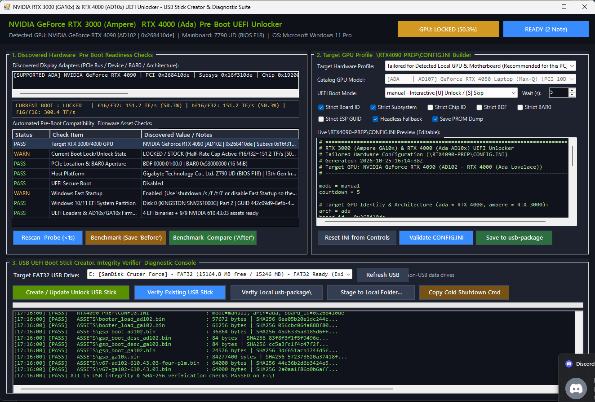

# RTX 3000 / 4000 Windows UEFI Tensor Core unlock experiment

Windows tools for discovering hardware, generating a runtime profile, staging a FAT32 UEFI USB drive, and measuring FP16/BF16 Tensor Core throughput with FP32 accumulation. This changes Tensor Core instruction issue rates; it does not raise the GPU power limit or guarantee gaming performance gains.

**Status: experimental. This project is not validated for production or for every RTX 3000/4000 card.** The PCI catalog recognizes Ampere GA10x and Ada AD10x devices, including mobile IDs. Recognition, shared architecture signatures and successful compilation do not prove that firmware execution, reset, display recovery or Windows handoff works on a particular board. No physical preboot compatibility matrix has been established for this port. See [REVIEW.md](REVIEW.md).

## GUI preview



Example screenshot; detected hardware, measurements and readiness results depend on the current system. A readiness result does not establish successful preboot unlocking.

## Build from source

For a ready-to-run download, use the **[latest portable Windows x64 release](https://github.com/Glat0s/gpu-unlock-windows-generic/releases/latest)**. Download `gpu-unlock-*-windows-x64-portable.zip` (not GitHub's automatic source ZIP), right-click it, select **Extract All**, then double-click `Launch-UsbCreator.cmd` in the extracted folder. Keep the entire folder together. No installer, Python, Zig, CUDA Toolkit or Visual Studio is needed to create USB media or run the included benchmarks. Windows 10/11 x64, Windows PowerShell 5.1 and a compatible NVIDIA GPU driver are required. Rebuilding and the optional Python research utilities still require development tools.

The portable ZIP contains all three EFI loaders, the nine pinned firmware assets, generic configuration, benchmark executables, CUDA runtime libraries, license notices and matching source. It works offline after download. Benchmark reports and profiles are written beside the application, so extract it somewhere writable, such as Downloads or a user-owned tools folder. To check an untouched extraction, run `powershell -NoProfile -ExecutionPolicy Bypass -File .\Verify-Portable.ps1`; the release also includes a `.zip.sha256` checksum. Verification detects subsequent edits to included profiles as well as corruption.

GitHub's **Code / Download ZIP** is the source distribution. The ignored `tools/` folder contains the compiler, and `usb-package/` contains generated output; neither is required in Git because the portable release supplies the runtime payload. Source builds follow the steps below.

Use Windows x64, Python 3.14+ (for extracting the pinned tar.zst firmware package), and Zig 0.14.1. Extract Zig into `tools/zig-x86_64-windows-0.14.1`, or set `ZIG_EXE` to its executable. Compiler caches stay under `build/`.

```powershell
python prepare_assets.py
python build.py
python test.py
powershell -NoProfile -ExecutionPolicy Bypass -File tests/Test-Application.ps1
```

`prepare_assets.py` downloads pinned source artifacts and generates/verifies nine Ada and Ampere firmware files against `firmware-manifest.json`. `build.py` compiles the manual, automatic and read-only probe EFI applications, validates their PE structure, stages verified firmware and resets the package configuration to generic defaults. It never includes a local hardware header unless explicitly compiled with `GU_USE_LOCAL_BOARD`. Build output is under `build/` and `usb-package/`; these folders are generated and excluded from Git.

## Create a USB drive

Run `Launch-UsbCreator.cmd`. The GUI discovers the current machine each time it starts and provides refresh controls. Review the discovered GPU, ESP, Secure Boot and other readiness checks. Missing permissions or unavailable hardware are not proof of compatibility. Use an elevated PowerShell session when Windows denies storage inspection.

For direct PowerShell use, launch `powershell.exe -NoProfile -ExecutionPolicy Bypass -STA -File .\UsbCreatorGui.ps1`. Source checkouts need a build first; portable releases are already built.

Choose the local tailored profile, generic discovery, or a catalog model. Inspect the INI preview. Select an existing FAT32 USB drive and create the package. The application copies files; it does not format disks. Existing application files and `EFI/BOOT/BOOTX64.EFI` on the target are overwritten. Keep other boot media separate.

Filesystem detection handles both Windows volume properties and a direct Windows filesystem query, with additional fallbacks. If detection fails, the log includes the Windows query error. Error 1005 means Windows did not recognize the volume's filesystem at the time of the query; the app refuses to write until a FAT32 filesystem can be confirmed.

```powershell
.\Stage-Usb.ps1 -DriveLetter E: -Mode manual
.\Stage-Usb.ps1 -DriveLetter E: -Mode manual -Generic
.\Stage-Usb.ps1 -FolderPath .\build\staged-usb -Generic
.\Stage-Usb.ps1 -FolderPath .\build\staged-usb -VerifyOnly
```

Manual mode offers unlock, skip, or return to firmware. Probe mode installs the read-only diagnostic loader. Automatic mode runs the unlock after a countdown. The unsigned loaders require Secure Boot disabled. Use your motherboard's UEFI boot menu after a full shutdown; shutdown does not necessarily remove GPU standby power. Firmware cold-state checks remain authoritative. Keep Windows recovery credentials available before changing firmware boot settings.

The loader selects a catalog GPU, checks its live PCI/MMIO state and uses runtime `RTX4090-PREP/CONFIG.INI` settings. Generic mode requires an unambiguous target and Windows boot volume. It can refuse systems with multiple candidates. Diagnostic files written to the USB may contain machine-specific information.

## Benchmarks

Portable releases include the benchmark executables and their CUDA libraries. For source builds, install the CUDA Toolkit and supported MSVC x64 C++ build tools. Build from a Visual Studio x64 developer shell or use automatic installation discovery:

```powershell
.\benchmark\Build-Benchmark.ps1
.\benchmark\Run-Benchmark.ps1 -SaveAsBaseline
# Reboot via the USB, then:
.\benchmark\Run-Benchmark.ps1
```

Each full run saves a timestamped human-readable report under `benchmark-reports/` beside the application, with floating-point rates in TFLOPS, integer rates in TOPS, raw repetitions, numerical validation and before/after comparison when the most recent baseline matches the GPU and driver identity. CUDA tools currently use CUDA device 0. Do not assume that this matches a different GPU chosen in the USB profile on multi-GPU systems.

The lock/unlock badge is a throughput-ratio estimate, not a register read or proof of firmware success. Clocks, thermals, power and competing workloads affect measurements. Missing or failed numerical validation is an error, and the CLI exits unsuccessfully. Quick startup probes skip numerical validation.

## Repository hygiene and licensing

Maintainers can generate the release on a Windows x64 build machine with Python, Zig, CUDA and MSVC installed:

```powershell
python package_portable.py --version v0.1.0 --cuda "C:\Program Files\NVIDIA GPU Computing Toolkit\CUDA\v13.2"
```

This rebuilds EFI and benchmarks, runs host/application checks, resolves benchmark DLL imports, and writes the portable ZIP and SHA-256 sidecar under `dist/`. It fails on unresolved dependencies. CUDA's cuBLASLt library is included explicitly because it can be loaded dynamically. The benchmark programs use the static MSVC runtime. Source files are selected from Git's tracked file list and current working tree; commit or stage new source files before packaging. Downloaded compilers, caches, local hardware headers, inventories and USB logs are excluded. Publish both files from `dist/` as GitHub release assets with the matching source commit/tag.

Hardware inventory is saved only with `Tailor-MyHardware.ps1 -SaveInventory`. Runtime profiles, reports, local headers, firmware, downloaded compilers and binaries are excluded from Git. Rebuild the generic package before distributing it. Do not commit USB logs or private inventory.

This is a mixed-license project. See [THIRD_PARTY_NOTICES.md](THIRD_PARTY_NOTICES.md) and `LICENSES/`. GPL source, MIT source, EDK2 headers and NVIDIA firmware retain their respective notices; a blanket MIT label would be incorrect. Firmware generation downloads licensed NVIDIA artifacts rather than adding generated firmware to the source repository.
